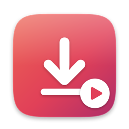

<p align="center">
  
</p>

<h1 align="center">Snag</h1>

<p align="center">
  A native YouTube downloader for macOS that always grabs the best quality there is:<br>
  4K, HDR and AV1 video, original audio, subtitles, thumbnail and description, signed in through your own browser.
</p>

<p align="center">
  
  
  
  
</p>

---

## Install

```sh
brew install --cask nurik-dz/tap/snag
```

Homebrew also installs the download engine Snag drives: [yt-dlp](https://github.com/yt-dlp/yt-dlp),
[ffmpeg](https://ffmpeg.org) and [deno](https://deno.com).

To install by hand instead: `brew install yt-dlp ffmpeg deno`, then download `Snag.zip` from
[Releases](https://github.com/Nurik-dz/Snag/releases/latest), unzip it and move **Snag.app** to Applications.
Snag is not notarized; if macOS blocks it, open **System Settings → Privacy & Security** and choose **Open Anyway**, or run:

```sh
xattr -dr com.apple.quarantine /Applications/Snag.app
```

## Features

- **Paste a link, get the best version.** Videos, Shorts, playlists and whole channels (`@handle`).
- **Plays everywhere.** 4K AV1 and Opus are packed into MP4 files that open in QuickTime. When a video only exists as
  VP9, Snag converts it to HEVC with the Mac's hardware encoder at the same resolution (or keeps the VP9, your choice).
- **Audio**: original (Opus copied untouched into `.m4a`), AAC 256 kbps, MP3 320 kbps, FLAC or WAV.
- **Subtitles**: SRT, VTT or both. YouTube's rolling auto-captions are cleaned up to one line each.
- **Thumbnail** at full 1280×720 (no re-encoding) and the **description** as a text file.
- **Signed in through your browser**: Brave, Chrome, Edge, Firefox, Vivaldi, Opera, Chromium or Safari, so videos that
  need your account (age-restricted, members-only) download too.
- Download list with progress in the Dock, notifications when done, pause and resume.
- Appearance: Liquid Glass, Frosted or Solid; light, dark or system.

## Sign-in and Full Disk Access

To read your browser's sign-in, macOS requires **Full Disk Access** for Snag
(System Settings → Privacy & Security → Full Disk Access). Without it, public videos still work and the window shows
**Not signed in yet**. Chromium-based browsers ask once for your login password to unlock their cookie store
(choose **Always Allow**).

## Use Snag from Claude

Snag ships with `snag-mcp`, a small [MCP](https://modelcontextprotocol.io) server inside the app. In
**Settings → Claude**, click **Connect** to register it with Claude Code and the Claude desktop app. Claude can then:

| Tool | What it does |
| --- | --- |
| `snag_lookup` | Title, channel, length and every available quality for a video, Short, playlist or channel |
| `snag_download` | Queues a download in the running Snag app (it appears in the Downloads list) |
| `snag_status` | Progress of current and recent downloads |
| `snag_transcript` | A video's transcript as plain text |

Try: *"use Snag to download this video in 4K"*.

To connect by hand: `claude mcp add snag -s user -- /Applications/Snag.app/Contents/MacOS/snag-mcp`

## Build from source

Requires macOS 26 or later, the Xcode Command Line Tools (`xcode-select --install`) and `brew install yt-dlp ffmpeg deno`.

```sh
git clone https://github.com/Nurik-dz/Snag.git
cd Snag
./build.sh          # builds Snag.app (app + snag-mcp helper) in this folder
open Snag.app
```

## Tests

```sh
Tests/run.sh engine <link> <output-folder> [video,audio,subs,thumb,desc] [max-height]
```

Looks up a real video and downloads it with the chosen parts into the output folder.

## Project layout

```
Sources/
  App/       app entry point
  Engine/    yt-dlp / ffmpeg driver, format choice, subtitles, tool discovery
  Model/     settings and download records
  State/     app model and download queue
  System/    Dock progress, notifications
  Views/     SwiftUI screens
MCP/         snag-mcp, the MCP server (stdio)
Tests/       engine test
tools/       icon generator
```

## Good to know

- YouTube occasionally answers an unsigned request with HTTP 403; Snag looks the video up again and retries once.
- Keep the engine fresh with `brew upgrade yt-dlp` when YouTube changes something.

## License

[MIT](LICENSE) © 2026 Nurik-dz. Snag drives yt-dlp, ffmpeg and deno, which are installed separately under their own licenses.
